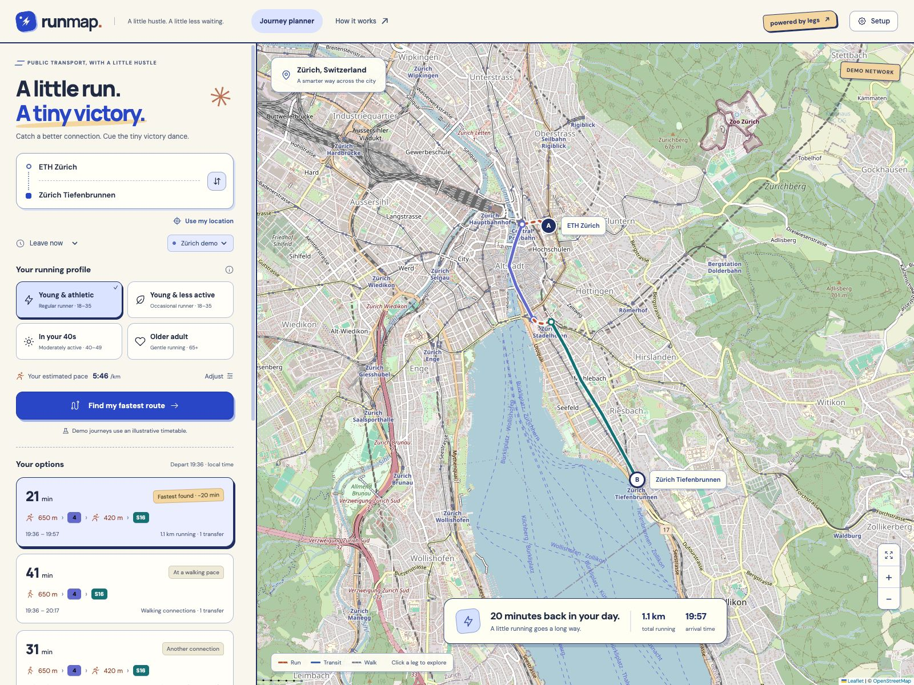

# RunMap

A local transit planner that treats walking connections as opportunities to run. Compare walking and running itineraries, see route lines on an interactive map, and follow every access leg, wait, vehicle and transfer.

[](docs/images/runmap-demo.jpg)

*Illustrative Zürich demo with synthetic routes and timetables. Click the picture to view it at full resolution (1600 × 1200).*

## Start

Double-click **`start.command`** in this folder. It starts the local server and opens the planner at **http://127.0.0.1:8787**. Keep its terminal window open while using RunMap; press Control-C to stop it.

From the project folder, run:

```sh
.venv/bin/python -m runorwalk.server
```

For a fresh installation, use Python 3.11 or later:

```sh
python3 -m venv .venv
.venv/bin/pip install -e '.[dev]'
.venv/bin/python -m runorwalk.server --open
```

No frontend build or Node installation is needed. The server binds only to `127.0.0.1`. If port 8787 is occupied, pass `--port 8788` and change the extension's planner address to match.

## Try the demo

The default **ETH Zürich → Zürich Tiefenbrunnen** example shows how running can catch an earlier tram and train. Change the endpoints, running profile, departure time, total running limit or boarding buffer. Click a route to compare it, or a journey leg to focus the map.

The demo supports ETH Zürich, Zürich HB, Central, Bellevue, Zürich Stadelhofen, Zürich Tiefenbrunnen, Kunsthaus Zürich and Paradeplatz. It uses a small synthetic timetable anchored to the requested departure; changing the time shifts the example. Its service labels, paths and timings are illustrative and must not be used as actual travel directions. OpenStreetMap tiles require an internet connection; the routing calculation itself runs locally.

## Connect Google Maps

1. In [Google Cloud Console](https://console.cloud.google.com/), create/select a project with billing enabled. Enable **Routes API** and **Maps JavaScript API**. The old Directions API is not required by the new planner.
2. Copy `.env.example` to `.env` and configure two separate keys:

   ```dotenv
   GOOGLE_MAPS_API_KEY=server_key_for_routes_api
   GOOGLE_MAPS_BROWSER_KEY=browser_key_for_maps_javascript_api
   ```

3. Restrict the server key to Routes API and, where practical, the server's public IP. Restrict the browser key to Maps JavaScript API and HTTP referrers `http://127.0.0.1:8787/*` and `http://localhost:8787/*` if used. The browser key is intentionally public; the server key stays on the server.
4. Restart the server, reload the page and select **Google Maps** in the route-source selector.

Live searches accept addresses, place names or `latitude,longitude`. They use the Google Routes v2 API, with at most **12 requests per search**; requests can incur Google charges. Live routes appear only on a Google map. Without the browser key, the itinerary remains available and the map explains how to connect it. Transit availability depends on Google's geographic and timetable coverage. A missing key or provider failure never silently becomes a demo result.

Choose **Use my location** below the address fields to set your starting point. Allow location access when your browser asks; a successful fix selects Google Maps mode. Then choose your destination and find a route. Location is requested once per click, kept only in memory, and sent to Google when you search. You can cancel a pending request, swap the endpoints, or type an address instead. If the in-app browser cannot locate you, open the same local URL in your usual browser.

## Chrome extension

1. Open `chrome://extensions` in Chrome.
2. Enable **Developer mode**, click **Load unpacked**, and select this project's **`extension`** folder.
3. Keep the RunMap server running. Open a Google Maps directions page and click the **RunMap** extension or its on-page button.
4. Review or edit the imported origin and destination, then open the planner.

The extension sends the endpoints to the local app. It does not modify Google's internal routing algorithm or scrape transit timetables. The popup accepts a different planner address if needed. See [extension/README.md](extension/README.md) for permissions and details. Extension URL parsing is tested; loading the unpacked extension in Chrome has not been manually verified here.

## Running model

The four editable defaults are **planning scenarios**, not measured population averages:

| Profile | Assumed VMA | Speed at 65% effort |
| --- | ---: | ---: |
| Young, athletic | 16 km/h | 10.4 km/h |
| Young, less active | 11 km/h | 7.15 km/h |
| In your 40s | 12 km/h | 7.8 km/h |
| Older adult (65+) | 9 km/h | 5.85 km/h |

VMA is maximal aerobic speed. The planner multiplies VMA by the selected effort to estimate a running speed, then adds 20 seconds per running leg for slowing and orientation. This is a simple approximation: hills, stairs, lights, crowding, fatigue and individual ability are not modelled. Enter a measured VMA if available. The default 65% is a configurable assumption, not a universal fitness prescription.

Age and training influence aerobic fitness, but neither gives a reliable exact VMA by itself. Research context: the [HUNT longitudinal fitness study](https://pubmed.ncbi.nlm.nih.gov/32971113/) and [research on maximal aerobic speed and running economy](https://pmc.ncbi.nlm.nih.gov/articles/PMC9547581/). These papers do **not** establish the numerical presets above.

## What the optimizer does

- Requests scheduled transit alternatives from the selected provider.
- Evaluates each complete itinerary from the requested departure time, preserving actual vehicle departure and arrival times.
- Branches between walking and running at access, transfer and final destination legs, respecting a cumulative running-time budget and a 1,500 m per-leg cap.
- Requests onward journeys from stops reached earlier by running; preserves the original prefix instead of presenting only the onward journey.
- Includes a configurable boarding buffer and explicit waiting time, rejects missed connections and disconnected route segments, and sorts results by arrival time.
- Normalizes time arithmetic to UTC, including daylight-saving transitions.

**“Fastest found” means fastest among the checked alternatives.** Google's API has no walking-speed parameter and does not expose the entire transit graph. The bounded search cannot guarantee a global optimum or find every possible boarding stop. It reports incomplete searches. If only a running itinerary is feasible, it shows that route without inventing a walking comparison. Google Maps links reopen the endpoints and recalculate at Google's walking pace; they do not preserve RunMap's chosen connections or running times.

## Project layout

```text
runorwalk/server.py       Local HTTP API and static file server
runorwalk/planner.py      Schedule-aware running-transfer search
runorwalk/providers.py    Google Routes v2 provider and parser
runorwalk/demo.py         Synthetic Zürich network
runorwalk/profiles.py     Editable VMA defaults and validation
runorwalk/static/         Interface, maps, bundled Leaflet 1.9.4
extension/               Chrome Manifest V3 companion
tests/                  Offline routing, provider and server tests
```

The original `routing.py`, `google_directions.py`, `running_model.py` and CLI are preserved as the legacy prototype. The new web planner uses `planner.py` and `providers.py`, which fix timetable and complete-itinerary limitations in that earlier implementation.

## Verification

```sh
.venv/bin/python -m pytest -q
node --check runorwalk/static/app.js
```

Run the extension tests using the command in `extension/README.md`.

Tests cover cumulative budgets, missed services, waiting, multiple transfers, final running legs, unordered alternatives, last-train routes with no walking baseline, daylight-saving transitions, incomplete geometry, mocked Google requests, input validation and local-server boundaries. The interface is also checked in the in-app browser.

## Privacy and sources

The app keeps no route history, analytics or accounts. The server does not log requested addresses. Demo map tiles are fetched from OpenStreetMap, fonts from Google Fonts; those services receive normal browser connection information. Live mode sends trip endpoints, coordinates and requested times to Google. Extension settings store only the planner address. Privacy and terms are also available inside the interface.

Google API references: [transit routes](https://developers.google.com/maps/documentation/routes/transit-route), [computeRoutes](https://developers.google.com/maps/documentation/routes/reference/rest/v2/TopLevel/computeRoutes), [attribution policies](https://developers.google.com/maps/documentation/routes/policies). Maps use the bundled [Leaflet](https://leafletjs.com/) library under its included license and [OpenStreetMap](https://www.openstreetmap.org/copyright) data in demo mode.
